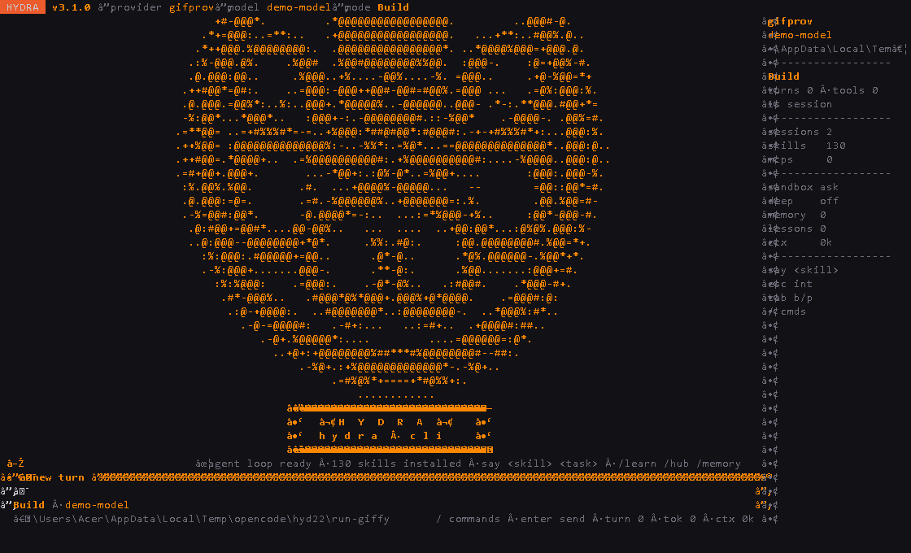
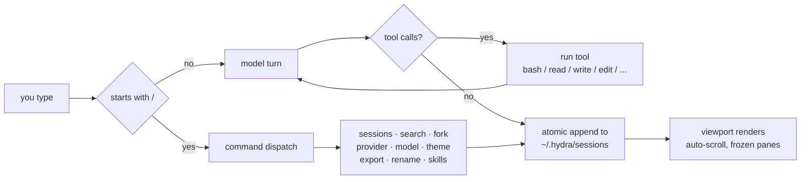
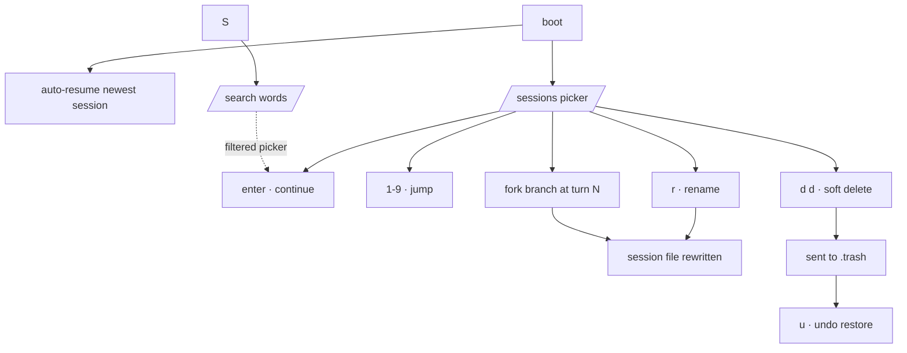
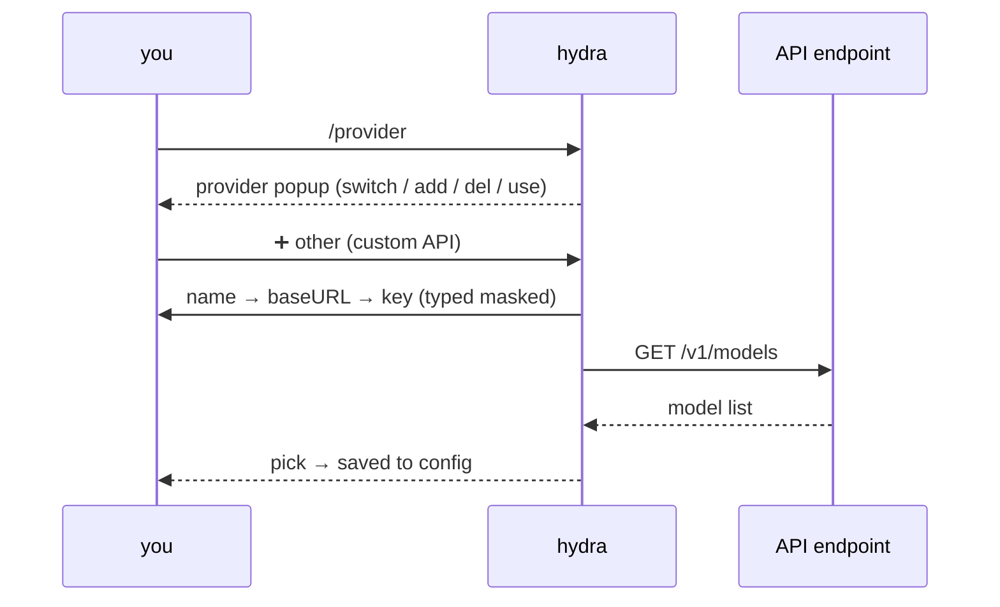

<div align="center">

```
        ● HYDRA ●
  h y d r a  ·  c l i
```

# ⬢ hydra-cli

[]()
[](https://github.com/hydra-eng/hydra-cli/actions/workflows/ci.yml)
[]()
[]()
[](LICENSE)

**a terminal AI coding agent with a real tool loop, self-written skills and cinematic session UX — one file (`hydra.mjs`), zero dependencies, `node hydra.mjs` and go.**



</div>

---

## ✨ why hydra

- **one file, zero deps** — `hydra.mjs`. No npm install, no bundlers, no framework. Run it, delete it, run it again.
- **agentic tool use** — the model gets `bash / read / write / edit / list / glob / grep` tools and loops until the job is done. Tool steps fold into the saved reply as a `[work log]` tail, so the next turn keeps the receipts instead of redoing the same work.
- **opencode-style sessions** — every turn auto-saves (atomic, lock-retry writes with visible failure notes), `/sessions` opens a full-screen picker with a live preview pane.
- **full-text session search** — `/search deep dive` finds the words across every past session and drops you in a pre-filtered picker.
- **session forking** — `/fork 30` branches a long conversation up to a chosen turn into a brand-new session, like `git branch` for chat.
- **palettes on the fly** — `/theme` swaps the whole UI between five hand-tuned palettes, instantly and persistently.
- **paste a key, done** — `/key <paste>` (or `➕ paste api key` in the provider popup) detects the vendor from the key's shape — zen, OpenAI, OpenRouter, Groq, Gemini, Hugging Face, NVIDIA — connects, lists models, auto-picks one. No baseURL questions. Ever.
- **one-step connect** — model ids are saved clean (quotes stripped), and a bad model id tells you exactly how to fix it instead of failing silently.
- **bring any OpenAI-compatible endpoint** — `/provider` → `➕ other (custom API)` still walks through name → baseURL → key (masked) → live `/models` fetch → pick when you want full control.
- **terminal polish** — hand-drawn banner splash, double-width-safe wraps, frozen viewport while you scroll (new logs never yank your view), mouse wheel + click + drag-select, clipboard paste.

---

## 🧠 hermes-grade learning loop

Inspired by the Hermes Agent's design: hydra is not just a chat shell — it learns, keeps memory, writes its own skills, and gates its own dangerous commands.

- **skills it writes itself** — the model can save reusable skills (`~/.hydra/skills/<name>/SKILL.md`, front matter + body) via the built-in `skill_write` tool. A skill's `description` always rides in the system prompt; the body loads on demand. Start a message with the skill's name and its guide is injected automatically — no slash command needed.
- **memory that survives sessions** — the model saves durable facts with `memory_write` (deduped, capped) into `~/.hydra/memory.md`, always in context. Lessons from every turn (topic, tools used, outcome) append to `~/.hydra/learnings.jsonl` and the last 5 ride in the system prompt — a real self-improvement loop.
- **`/learn <text | url | file>`** — hand hydra raw material and a distillation turn converts it into a reusable skill (never copies passages) and saves it itself.
- **skills hub** — `/hub` opens the remote catalog (one flat `hub.json`); `enter` installs a skill after a security scan (secrets, eval-tampering patterns) into your local skills dir. Env `HYDRA_HUB_URL` / `HYDRA_HUB_BASE` point the hub anywhere.
- **sandbox controls** — `/sandbox ask|strict|open` (default `ask`): risky commands (`rm -rf` family, `format`, reg edits, `IEX`, force-push…) ask a `y`/`n` footer prompt before running; `strict` blocks them outright. Env override `HYDRA_SANDBOX`. Auto-worked sessions (no TTY) are auto-denied.
- **deep terminal** — short one-line `bash` tool calls run inside a persistent hidden PowerShell child, so `cd`, env vars and venv activation persist call to call like a real working terminal; everything else uses the one-shot runner. `esc` still interrupts.
- **write-approval gate** — `/skills-safe on` makes `skill_write` require a `y` confirmation before the model can add, change or delete a skill. Removed skills go to `skills/.trash/` (as with sessions: nothing is hard-deleted).
- `/memory` prints the remembered set; `/skills` lists installed skills with their triggers.
- **the UI shows the living agent loop** — the right rail rows out sandbox mode, deep-terminal state, memory facts, lessons and the context gauge (all live-updating), a header badge appears when the sandbox runs non-default, `/stats` reports the agent-loop state, and boot announces "agent loop ready · N skills installed · say <skill> <task>".
- **ai-cli-grade turn ergonomics** — type a new prompt while a turn runs and it **queues** (slug cue in the composer box crown, then runs right after — no more "busy" rejections); the footer shows the **ctx gauge** (≈ tokens in the live history, turns amber-red past ~90k chars with a `/clear` nudge); `@file` mentions **glue a file into your message** (≤ 4 files, ≤ 240 KB each, logged as "⌘ attached"); `write`/`edit` tool calls print a compact **± diff preview** in the log; long turns tap the terminal bell when they finish; the model keeps a **visible checklist** (`todo_write`) that rides the right rail as `todo open/total`; and the whole surface got a **boxed composer** (bordered two-row prompt with a live queue cue), a `╢` rule rail, **log flash-in animation** on fresh rows, themed **toast cards** (spinner-ticked, fade out on their own — hit the `⌘` copy rows and clipboard ops), 🐭 **drag-select auto-copy** with toast, `ctrl+a` copy-whole-screen, `esc` clears the selection, and `ctrl+c` behaves Claude-style: first press copies the selection / clears the prompt, a second press exits.

## 🧰 agentic toolbox

The agent-loop round — context discipline, safety rails, side quests and self-repair, all key- or slash-reachable:

- **context governance** (`ctrl+p` · `/ctx` · `/purge`) — the model window runs on a live tokens budget: when a turn gets long, hydra trims whole older turns out of the context face and stamps both ends (`[context: N older messages trimmed…]`) so the model knows what it dropped — the session file itself always keeps every word. `/ctx` (or the same picker) **parks and unparks whole turns** on the fly; `/purge [keep]` compacts stale exchanges after a `/time` checkpoint saves the full text first; the `ctx` rail row shows live window tokens (`ctx 12k`, `*` = parked turns in play).
- **time travel** (`/time`) — every finished turn snapshots to `~/.hydra/checkpoints` (capped at 24). The dialog lists snapshots with a live preview; `enter` rewinds the chat and replays it turn by turn, exactly as it happened.
- **permission zones** (`.agentrules`) — a flat file of `deny|allow|ask <regex>` lines in your repo gates every shell step the agent wants to run: `deny` blocks outright, `ask` prompts y/n in the footer, the rest falls through to the sandbox. Workspace rules shadow global ones (`~/.hydra/.agentrules`). `/zone` / `/rules` prints what's loaded.
- **macro recording** (`ctrl+r` · `/rec` · `/macro`) — flip ctrl+r on and every shell step the agent runs is captured until you stop; `/rec <name>` writes a replayable skill into `~/.hydra/skills/macro-<name>/` and `/macro <name>` runs the steps back again.
- **diagnostic cards + `/fix`** — when a tool call dies with a recognised error, a compact card lands in the log ("cannot find module 'x'" → suggests `npm install x`). `/diag` prints all open cards; `/fix` works the newest one through repair heuristics, parked safely after 3 failed tries.
- **dependency radar** — right after `write`/`edit`, hydra scans the workspace for what imports the fresh file and logs the fan-out (`radar fan-out: 3 referencing src/app.js`), with `↳` file:line lines and a rail readout.
- **lane B** (`/lane`) — a second agent runs your next prompt with its **own history clone**, streaming `‹b›` deltas side-by-side above the main turn; esc aborts it, and neither side auto-merges.
- **ghost-write** — the composer completes from your prompt history as you type (a dim tail after the caret); `tab` accepts it.
- **telemetry** — per-turn token counter on the footer (`tok 3 · ctx 6k`), chars/sec while a reply streams (`· 40 c/s`), rec/radar/card/fan-out lights on the right rail.

## 👼 palettes

| command | look |
|---|---|
| `/theme crimson` | the signature red on black |
| `/theme gold` | brass and amber |
| `/theme matrix` | phosphor green |
| `/theme ice` | cold steel blue |
| `/theme mono` | pure grayscale |

Bare `/theme` opens a popup — arrow keys + `enter` apply and save the choice to `~/.hydra/config.json`.

## 🚀 quickstart

```powershell
# Windows (PowerShell). Node >= 20. Anything OpenAI-compatible on the other side.
irm -Uri https://raw.githubusercontent.com/hydra-eng/hydra-cli/master/install.ps1 | iex
```

…or by hand:

```powershell
irm -Uri raw.githubusercontent.com/hydra-eng/hydra-cli/master/hydra.mjs -OutFile hydra.mjs
node hydra.mjs
```

First run writes `~/.hydra/config.json` with a default local provider:

```json
{
  "active": "ollama",
  "providers": {
    "ollama": { "name": "ollama", "baseURL": "http://localhost:11434/v1", "apiKey": "", "model": "llama3:latest" }
  }
}
```

…or just run `/provider`, pick `➕ other (custom API)` and hydra pulls the model list from the endpoint itself.

### how a turn works



### session lifecycle



### custom provider discovery



## 🎛 controls

| action | key |
|---|---|
| browse sessions | `/sessions` · arrows / click / wheel · `enter` continue · `1-9` jump · `r` rename · `d d` delete · `u` undo |
| resume newest | `/resume` |
| full-text search | `/search <words>` |
| fork from turn N | `/fork <turn>` |
| switch palette | `/theme [name]` |
| pause generation | `esc` (also aborts lane B) |
| build / plan mode | `tab` |
| govern picker | `ctrl+p` — context budget · park/unpark · time travel · stats · diag cards in one menu |
| park or unpark turns | `/ctx` · `ctrl+g` — kept out of the model window, back in on demand |
| purge stale exchanges | `/purge [keep]` — runs after an automatic checkpoint, `/time` keeps the full text |
| time travel | `/time` — rewind to any checkpoint and replay turn by turn |
| zone rules | `.agentrules` in your repo (`deny|allow|ask <regex>`) · `/zone` / `/rules` lists them |
| record a macro | `ctrl+r` or `/rec` · `/rec <name>` stops and saves the skill |
| replay a macro | `/macro <name>` |
| tool error cards | `/diag` prints them · `/fix` works the newest |
| second agent lane | `/lane` streams a history-cloned run above the main turn · `esc` aborts |
| prompt ghost | type a familiar prompt and `tab` completes it from your history |
| scrollback | `pgup / pgdn`, `shift+↑/↓`, mouse wheel |
| queue a switch mid-reply | `/sessions` works **while a turn is running** — it switches automatically after the reply |
| `/model <n\|name>` | switch model — the list **always refreshes for the active provider**, so `qwen` and cloud models never get tangled |
| `/provider use <name>` | flip back to a previous provider (e.g. `/provider use ollama`) |
| `/undo` | remove the last exchange (user + reply) from the session |
| `/regen` | re-run the last user message - a failed turn keeps the question, so you can retry |
| `/web <url>` | fetch a page, strip it to text, inject into context - persisted with the next turn |
| `/stats` | turn counts, approx tokens, session file, cwd, model, palette |
| paste / copy | `ctrl+v` · drag-select ships straight to the clipboard |
| markdown export | `/export file.md` |
| shell | `! <command>` |
| teach a skill | `/learn <text\|url\|file>` → distills into `~/.hydra/skills/` |
| install from the hub | `/hub` → arrow keys → `enter` installs after a security scan |
| remove a skill | `/skill-del <name>` (goes to `skills/.trash/`) |
| see what the model remembers | `/memory`, `/skills` |
| sandbox | `/sandbox ask\|strict\|open` — risky tool commands ask **y/n** in the footer |

## ⚙️ providers & models

```
/key <paste>           paste your api key -> vendor auto-detected -> connected. that's the whole flow.
/provider              popup: switch · ➕ paste key (one step) · ➕ other = custom API (name → baseURL → key → live models)
/provider add myapi https://api.example.com/v1 sk-... gpt-x
/provider del myapi    /provider use myapi
/model                 live model list for the active provider
```

`HYDRA_MODEL_TIMEOUT` (ms, default 180000) guards hung endpoints; `HYDRA_MODEL_IDLE` (ms, default 90000) aborts only after a stream stays truly silent (local/never-stop providers are exempt); `HYDRA_TOOL_TIMEOUT` (ms, default 300000) kills long-running `bash` tool calls — the UI stays live during every tool, esc interrupts immediately, and the session is saved between tool steps. `HYDRA_NO_PS=1` falls back to `cmd.exe` for `!` only. Context-side knobs: `HYDRA_KEEP_MSGS` (model-window message cap, default 120), `HYDRA_CTX_MAX` (context-face token budget, default 24000), `HYDRA_MAX_STEPS` (agent steps per turn, default 100).

Nothing in the interactive paths blocks the event loop: clipboard ops are async with 3s caps, config is no longer re-read per frame, rendering skips ahead when the console can't keep up, and session saves are atomic (temp file + rename, lock-retry with a direct-write fallback; a save failure logs visibly). Every run appends a one-line-per-second heartbeat (loop lag, busy label, tool count, output backlog) to `~/.hydra/heartbeat.txt` — if a session ever feels stuck, `hydra` can be diagnosed from that file alone; crashes land in `~/.hydra/crash.log`.

Nothing in the interactive paths blocks the event loop: clipboard ops are async with 3s caps, config is no longer re-read per frame, rendering skips ahead when the console can't keep up, and session saves are atomic (temp file + rename). Every run appends a one-line-per-second heartbeat (loop lag, busy label, tool count, output backlog) to `~/.hydra/heartbeat.txt` — if a session ever feels stuck, `hydra` can be diagnosed from that file alone; crashes land in `~/.hydra/crash.log`.

## 🗂 sessions

Every reply is atomically appended under `~/.hydra/`. Deleted sessions go to `.trash/` and `u` undoes them. Forks write a fresh `fork-of-<name>.json`; provider, model, cwd and skills ride along when you switch.

## 🛠 development

```powershell
node --check hydra.mjs
# smoke-test scenarios (isolated config dir via HYDRA_CFG_DIR):
$env:HYDRA_CFG_DIR="$PWD\tmp-home"; $env:HYDRA_TEST="8"; node hydra.mjs
# ci-style smoke (mock provider, plain mode):
node tests/plain-smoke.mjs
```

Scenario numbers 1–27 drive the TUI end-to-end with zero human input: sessions & mouse (1–4), deep scrollback + export (5), rename (6), the custom-provider flow against a local mock `/v1/models` (7), palettes + search + fork (8), zombie-provider auto-skip (10), offline fallback (11), web injection + persistence (12), stale-popup protection (13), interrupt latency (14), skills + memory round-trip (15), sandbox y/n gating (16), skills hub install + deep-terminal cwd persistence (17), queued prompts + @file attach (18), full-session persistence + model-window probe (19), step-budget stop with a loud continue note + work-log fold + the receipts kept (20), context budget trim + parked turns + stale purge (21), checkpoint time travel (22), .agentrules zones (23), macro record → skill (24), radar fan-out scan (25), diagnostics card + ghost-write (26), lane B streaming + telemetry (27), and a screenshot driver used to render the images (9). The graphics in `docs/img/` come from the app's real ANSI frame stream — literally the TUI painting itself ([demo.gif](docs/img/demo.gif), [social-preview.png](docs/img/social-preview.png)).

## 🤝 community

- **[contribution guide](CONTRIBUTING.md)** — one file stays one file; new features ship with a proving scenario.
- **[`good first issue` tickets](https://github.com/hydra-eng/hydra-cli/labels/good%20first%20issue)** — self-contained starter work, labeled on purpose.
- **[discussions](https://github.com/hydra-eng/hydra-cli/discussions)** — usage questions, themes, skill sharing.
- **[changelog](CHANGELOG.md)** — every release, in plain words.

## 📄 license

MIT — see [LICENSE](LICENSE).
