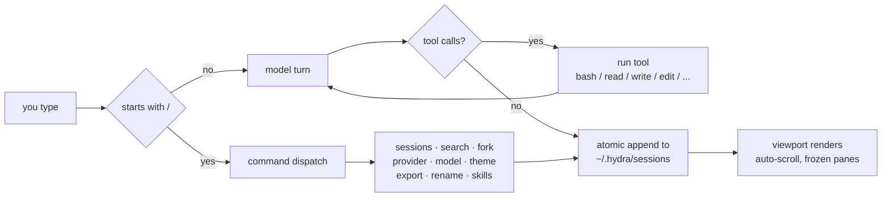
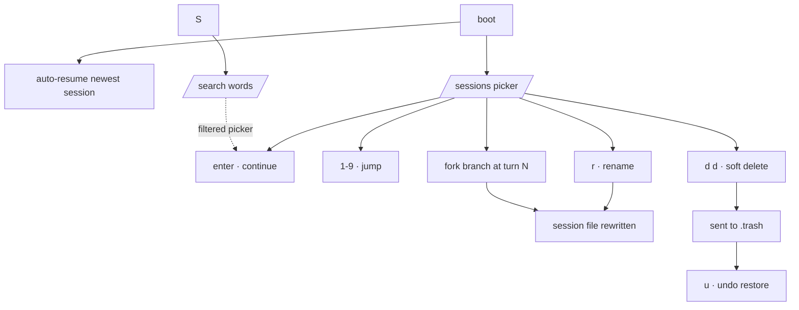
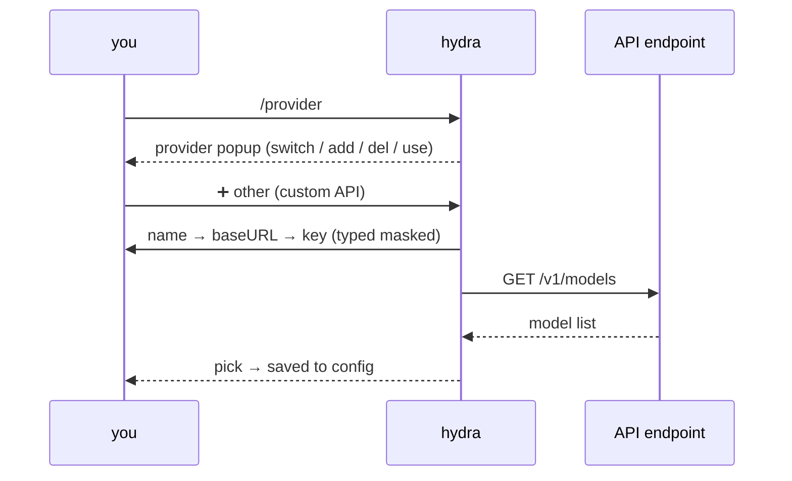

<div align="center">

```
        ● HYDRA ●
  h y d r a  ·  c l i
```

# ⬢ hydra-cli

[]()
[]()
[]()
[](LICENSE)

**A cinematic, zero-dependency terminal AI CLI for Windows.** One file, `node`, nothing else.


</div>

---

## ✨ why hydra

- **one file, zero deps** — `hydra.mjs`. No npm install, no bundlers, no framework. Run it, delete it, run it again.
- **agentic tool use** — the model gets `bash / read / write / edit / list / glob / grep` tools and loops until the job is done.
- **opencode-style sessions** — every turn auto-saves, `/sessions` opens a full-screen picker with a live preview pane.
- **full-text session search** — `/search deep dive` finds the words across every past session and drops you in a pre-filtered picker.
- **session forking** — `/fork 30` branches a long conversation up to a chosen turn into a brand-new session, like `git branch` for chat.
- **palettes on the fly** — `/theme` swaps the whole UI between five hand-tuned palettes, instantly and persistently.
- **paste a key, done** — `/key <paste>` (or `➕ paste api key` in the provider popup) detects the vendor from the key's shape — zen, OpenAI, OpenRouter, Groq, Gemini, Hugging Face, NVIDIA — connects, lists models, auto-picks one. No baseURL questions. Ever.
- **one-step connect** — model ids are saved clean (quotes stripped), and a bad model id tells you exactly how to fix it instead of failing silently.
- **bring any OpenAI-compatible endpoint** — `/provider` → `➕ other (custom API)` still walks through name → baseURL → key (masked) → live `/models` fetch → pick when you want full control.
- **terminal polish** — hand-drawn banner splash, double-width-safe wraps, frozen viewport while you scroll (new logs never yank your view), mouse wheel + click + drag-select, clipboard paste.

---

## 🧠 hermes-grade learning loop

Inspired by the Hermes Agent's design: hydra is not just a chat shell — it learns, keeps memory, writes its own skills, and gates its own dangerous commands.

- **skills it writes itself** — the model can save reusable skills (`~/.hydra/skills/<name>/SKILL.md`, front matter + body) via the built-in `skill_write` tool. A skill's `description` always rides in the system prompt; the body loads on demand. Start a message with the skill's name and its guide is injected automatically — no slash command needed.
- **memory that survives sessions** — the model saves durable facts with `memory_write` (deduped, capped) into `~/.hydra/memory.md`, always in context. Lessons from every turn (topic, tools used, outcome) append to `~/.hydra/learnings.jsonl` and the last 5 ride in the system prompt — a real self-improvement loop.
- **`/learn <text | url | file>`** — hand hydra raw material and a distillation turn converts it into a reusable skill (never copies passages) and saves it itself.
- **skills hub** — `/hub` opens the remote catalog (one flat `hub.json`); `enter` installs a skill after a security scan (secrets, eval-tampering patterns) into your local skills dir. Env `HYDRA_HUB_URL` / `HYDRA_HUB_BASE` point the hub anywhere.
- **sandbox controls** — `/sandbox ask|strict|open` (default `ask`): risky commands (`rm -rf` family, `format`, reg edits, `IEX`, force-push…) ask a `y`/`n` footer prompt before running; `strict` blocks them outright. Env override `HYDRA_SANDBOX`. Auto-worked sessions (no TTY) are auto-denied.
- **deep terminal** — short one-line `bash` tool calls run inside a persistent hidden PowerShell child, so `cd`, env vars and venv activation persist call to call like a real working terminal; everything else uses the one-shot runner. `esc` still interrupts.
- **write-approval gate** — `/skills-safe on` makes `skill_write` require a `y` confirmation before the model can add, change or delete a skill. Removed skills go to `skills/.trash/` (as with sessions: nothing is hard-deleted).
- `/memory` prints the remembered set; `/skills` lists installed skills with their triggers.
- **the UI shows the living agent loop** — the right rail rows out sandbox mode, deep-terminal state, memory facts, lessons and the context gauge (all live-updating), a header badge appears when the sandbox runs non-default, `/stats` reports the agent-loop state, and boot announces "agent loop ready · N skills installed · say <skill> <task>".
- **ai-cli-grade turn ergonomics** — type a new prompt while a turn runs and it **queues** (slug cue in the composer box crown, then runs right after — no more "busy" rejections); the footer shows the **ctx gauge** (≈ tokens in the live history, turns amber-red past ~90k chars with a `/clear` nudge); `@file` mentions **glue a file into your message** (≤ 4 files, ≤ 240 KB each, logged as "⌘ attached"); `write`/`edit` tool calls print a compact **± diff preview** in the log; long turns tap the terminal bell when they finish; the model keeps a **visible checklist** (`todo_write`) that rides the right rail as `todo open/total`; and the whole surface got a **boxed composer** (bordered two-row prompt with a live queue cue), a `╢` rule rail, **log flash-in animation** on fresh rows, themed **toast cards** (spinner-ticked, fade out on their own — hit the `⌘` copy rows and clipboard ops), 🐭 **drag-select auto-copy** with toast, `ctrl+a` copy-whole-screen, `esc` clears the selection, and `ctrl+c` behaves Claude-style: first press copies the selection / clears the prompt, a second press exits.

## 👼 palettes

| command | look |
|---|---|
| `/theme crimson` | the signature red on black |
| `/theme gold` | brass and amber |
| `/theme matrix` | phosphor green |
| `/theme ice` | cold steel blue |
| `/theme mono` | pure grayscale |

Bare `/theme` opens a popup — arrow keys + `enter` apply and save the choice to `~/.hydra/config.json`.

## 🚀 quickstart

```powershell
# Windows (PowerShell). Node >= 20. Anything OpenAI-compatible on the other side.
irm -Uri raw.githubusercontent.com/hydra-eng/hydra-cli/main/hydra.mjs -OutFile hydra.mjs
node hydra.mjs
```

First run writes `~/.hydra/config.json` with a default local provider:

```json
{
  "active": "ollama",
  "providers": {
    "ollama": { "name": "ollama", "baseURL": "http://localhost:11434/v1", "apiKey": "", "model": "llama3:latest" }
  }
}
```

…or just run `/provider`, pick `➕ other (custom API)` and hydra pulls the model list from the endpoint itself.

### how a turn works



### session lifecycle



### custom provider discovery



## 🎛 controls

| action | key |
|---|---|
| browse sessions | `/sessions` · arrows / click / wheel · `enter` continue · `1-9` jump · `r` rename · `d d` delete · `u` undo |
| resume newest | `/resume` |
| full-text search | `/search <words>` |
| fork from turn N | `/fork <turn>` |
| switch palette | `/theme [name]` |
| pause generation | `esc` |
| build / plan mode | `ctrl+p` or `tab` |
| scrollback | `pgup / pgdn`, `shift+↑/↓`, mouse wheel |
| queue a switch mid-reply | `/sessions` works **while a turn is running** — it switches automatically after the reply |
| `/model <n\|name>` | switch model — the list **always refreshes for the active provider**, so `qwen` and cloud models never get tangled |
| `/provider use <name>` | flip back to a previous provider (e.g. `/provider use ollama`) |
| `/undo` | remove the last exchange (user + reply) from the session |
| `/regen` | re-run the last user message - a failed turn keeps the question, so you can retry |
| `/web <url>` | fetch a page, strip it to text, inject into context - persisted with the next turn |
| `/stats` | turn counts, approx tokens, session file, cwd, model, palette |
| paste / copy | `ctrl+v` · drag-select ships straight to the clipboard |
| markdown export | `/export file.md` |
| shell | `! <command>` |
| teach a skill | `/learn <text\|url\|file>` → distills into `~/.hydra/skills/` |
| install from the hub | `/hub` → arrow keys → `enter` installs after a security scan |
| remove a skill | `/skill-del <name>` (goes to `skills/.trash/`) |
| see what the model remembers | `/memory`, `/skills` |
| sandbox | `/sandbox ask\|strict\|open` — risky tool commands ask **y/n** in the footer |

## ⚙️ providers & models

```
/key <paste>           paste your api key -> vendor auto-detected -> connected. that's the whole flow.
/provider              popup: switch · ➕ paste key (one step) · ➕ other = custom API (name → baseURL → key → live models)
/provider add myapi https://api.example.com/v1 sk-... gpt-x
/provider del myapi    /provider use myapi
/model                 live model list for the active provider
```

`HYDRA_MODEL_TIMEOUT` (ms, default 180000) guards hung endpoints; `HYDRA_TOOL_TIMEOUT` (ms, default 300000) kills long-running `bash` tool calls — the UI stays live during every tool, esc interrupts immediately, and the session is saved between tool steps. `HYDRA_NO_PS=1` falls back to `cmd.exe` for `!` only.

Nothing in the interactive paths blocks the event loop: clipboard ops are async with 3s caps, config is no longer re-read per frame, rendering skips ahead when the console can't keep up, and session saves are atomic (temp file + rename). Every run appends a one-line-per-second heartbeat (loop lag, busy label, tool count, output backlog) to `~/.hydra/heartbeat.txt` — if a session ever feels stuck, `hydra` can be diagnosed from that file alone; crashes land in `~/.hydra/crash.log`.

## 🗂 sessions

Every reply is atomically appended under `~/.hydra/`. Deleted sessions go to `.trash/` and `u` undoes them. Forks write a fresh `fork-of-<name>.json`; provider, model, cwd and skills ride along when you switch.

## 🛠 development

```powershell
node --check hydra.mjs
# smoke-test scenarios (isolated config dir via HYDRA_CFG_DIR):
$env:HYDRA_CFG_DIR="$PWD\tmp-home"; $env:HYDRA_TEST="8"; node hydra.mjs
```

Scenario numbers 1–17 drive the TUI end-to-end with zero human input: sessions & mouse (1–4), deep scrollback + export (5), rename (6), the custom-provider flow against a local mock `/v1/models` (7), palettes + search + fork (8), zombie-provider auto-skip (10), offline fallback (11), web injection + persistence (12), stale-popup protection (13), interrupt latency (14), skills + memory round-trip (15), sandbox y/n gating (16), skills hub install + deep-terminal cwd persistence (17), and a screenshot driver used to render the images above (9). The `docs/img/*.svg` are generated from the app's real ANSI frame stream — literally the TUI painting itself.

## 📄 license

MIT — see [LICENSE](LICENSE).
