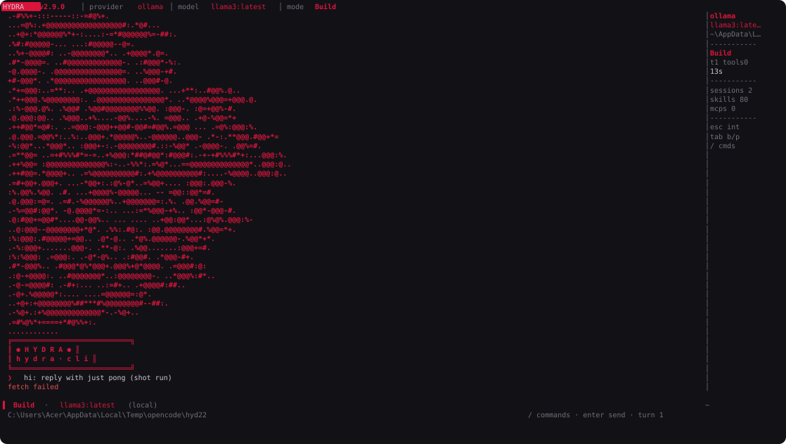
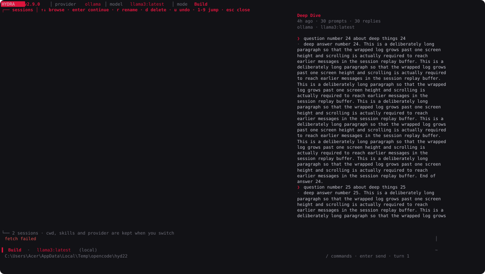
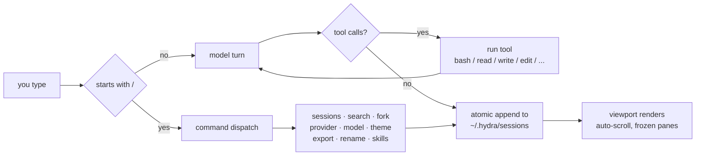
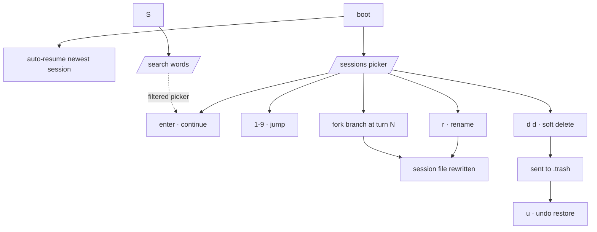
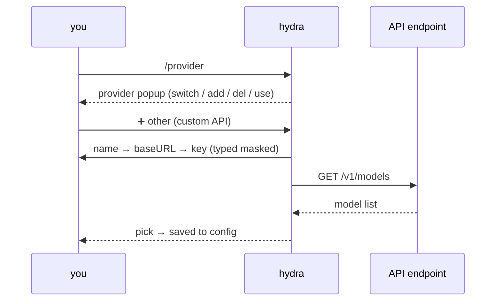

<div align="center">

```
        ● HYDRA ●
  h y d r a  ·  c l i
```

# ⬢ hydra-cli

[]()
[]()
[]()
[](LICENSE)

**A cinematic, zero-dependency terminal AI CLI for Windows.** One file, `node`, nothing else.




</div>

---

## ✨ why hydra

- **one file, zero deps** — `hydra.mjs`. No npm install, no bundlers, no framework. Run it, delete it, run it again.
- **agentic tool use** — the model gets `bash / read / write / edit / list / glob / grep` tools and loops until the job is done.
- **opencode-style sessions** — every turn auto-saves, `/sessions` opens a full-screen picker with a live preview pane.
- **full-text session search** — `/search deep dive` finds the words across every past session and drops you in a pre-filtered picker.
- **session forking** — `/fork 30` branches a long conversation up to a chosen turn into a brand-new session, like `git branch` for chat.
- **palettes on the fly** — `/theme` swaps the whole UI between five hand-tuned palettes, instantly and persistently.
- **bring any OpenAI-compatible endpoint** — `/provider` → `➕ other (custom API)` walks through name → baseURL → key (masked) → live `/models` fetch → pick.
- **terminal polish** — hand-drawn banner splash, double-width-safe wraps, frozen viewport while you scroll (new logs never yank your view), mouse wheel + click + drag-select, clipboard paste.

## 👼 palettes

| command | look |
|---|---|
| `/theme crimson` | the signature red on black |
| `/theme gold` | brass and amber |
| `/theme matrix` | phosphor green |
| `/theme ice` | cold steel blue |
| `/theme mono` | pure grayscale |

Bare `/theme` opens a popup — arrow keys + `enter` apply and save the choice to `~/.hydra/config.json`.

## 🚀 quickstart

```powershell
# Windows (PowerShell). Node >= 20. Anything OpenAI-compatible on the other side.
irm -Uri raw.githubusercontent.com/hydra-eng/hydra-cli/main/hydra.mjs -OutFile hydra.mjs
node hydra.mjs
```

First run writes `~/.hydra/config.json` with a default local provider:

```json
{
  "active": "ollama",
  "providers": {
    "ollama": { "name": "ollama", "baseURL": "http://localhost:11434/v1", "apiKey": "", "model": "llama3:latest" }
  }
}
```

…or just run `/provider`, pick `➕ other (custom API)` and hydra pulls the model list from the endpoint itself.

### how a turn works



### session lifecycle



### custom provider discovery



## 🎛 controls

| action | key |
|---|---|
| browse sessions | `/sessions` · arrows / click / wheel · `enter` continue · `1-9` jump · `r` rename · `d d` delete · `u` undo |
| resume newest | `/resume` |
| full-text search | `/search <words>` |
| fork from turn N | `/fork <turn>` |
| switch palette | `/theme [name]` |
| pause generation | `esc` |
| build / plan mode | `ctrl+p` or `tab` |
| scrollback | `pgup / pgdn`, `shift+↑/↓`, mouse wheel |
| queue a switch mid-reply | `/sessions` works **while a turn is running** — it switches automatically after the reply |
| paste / copy | `ctrl+v` · drag-select ships straight to the clipboard |
| markdown export | `/export file.md` |
| shell | `! <command>` |

## ⚙️ providers & models

```
/provider              popup: switch · ➕ other = custom API (name → baseURL → key → live models)
/provider add myapi https://api.example.com/v1 sk-... gpt-x
/provider del myapi    /provider use myapi
/model                 live model list for the active provider
```

`HYDRA_MODEL_TIMEOUT` (ms, default 180000) guards hung endpoints; `HYDRA_NO_PS=1` falls back to `cmd.exe` for `!` and the `bash` tool.

## 🗂 sessions

Every reply is atomically appended under `~/.hydra/`. Deleted sessions go to `.trash/` and `u` undoes them. Forks write a fresh `fork-of-<name>.json`; provider, model, cwd and skills ride along when you switch.

## 🛠 development

```powershell
node --check hydra.mjs
# smoke-test scenarios (isolated config dir via HYDRA_CFG_DIR):
$env:HYDRA_CFG_DIR="$PWD\tmp-home"; $env:HYDRA_TEST="8"; node hydra.mjs
```

Scenario numbers 1–9 drive the TUI end-to-end with zero human input: sessions & mouse (1–4), deep scrollback + export (5), rename (6), the custom-provider flow against a local mock `/v1/models` (7), palettes + search + fork (8), and a screenshot driver used to render the images above (9). The `docs/img/*.svg` are generated from the app's real ANSI frame stream — literally the TUI painting itself.

## 📄 license

MIT — see [LICENSE](LICENSE).
